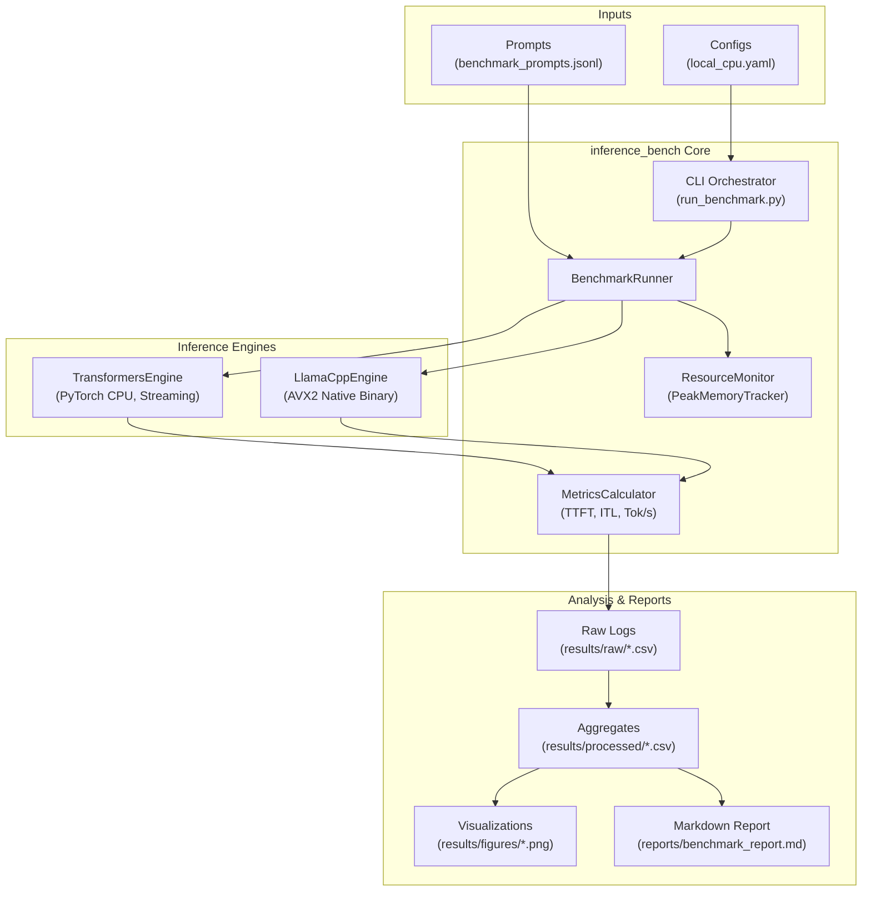

# LLM Inference Benchmark & Optimization Study: Latency, Throughput, Memory, and Quantization Trade-offs on Resource-Constrained Hardware

[](https://opensource.org/licenses/MIT)
[](https://www.python.org/downloads/)
[](https://www.microsoft.com/windows)
[](tests/)

An educational and technically rigorous machine learning systems project investigating the empirical relationship between **model size, inference latency, memory bandwidth, compute utilization, quantization, caching, and serving architecture** on severely resource-constrained hardware (dual-core mobile CPU with 4 GB system RAM).

---

## 1. Project Overview & Motivation

Deploying Large Language Models (LLMs) on resource-constrained edge hardware presents extreme memory and compute challenges. Unlike high-throughput data-center accelerators (e.g., NVIDIA H100 with 3.35 TB/s of HBM3 bandwidth), consumer CPU systems are severely bottlenecked by **main memory bandwidth (DDR3/DDR4: 12–25 GB/s)** and small CPU cache hierarchies.

This project investigates how inference-engine design, model quantization, and caching strategies alter the operational regime of transformer models, demonstrating that **autoregressive decoding is strictly memory-bandwidth bound** while **prompt prefill is compute-bound**.

### Core Research Questions
1. **Engine Overhead**: How does Hugging Face Transformers `generate()` compare with `llama.cpp` AVX2 inference on an identical 0.5B model?
2. **Phase Separation**: How do Time to First Token (TTFT, prefill) and Inter-Token Latency (ITL, decoding) scale with prompt length vs output length?
3. **Quantization Mechanics**: Why does 4-bit integer quantization (e.g., `Q4_K_M`) yield substantial decoding speedups on CPUs despite lower ALU precision?
4. **Caching Trade-offs**: How does prefix/prompt caching affect TTFT when common system instructions are repeatedly submitted?
5. **Roofline Analysis**: At what arithmetic intensity does inference transition from memory-bandwidth-bound to compute-bound?
6. **Edge vs. Cloud Validity**: What inferences can legitimately be generalized to production GPU serving, and what remains unique to CPU edge environments?

---

## 2. Hardware Profile & Resource Budget

The benchmark harness was verified and executed on an actual resource-constrained physical platform:

| Component | Specification | Operational Constraint |
| :--- | :--- | :--- |
| **Operating System** | Windows 10 Pro (64-bit, Build 19045) | Native Windows execution; no Docker or WSL2 required |
| **Processor (CPU)** | Intel Core i3-5005U @ 2.00 GHz | 2 Physical Cores, 4 Threads (Broadwell architecture) |
| **Vector Extensions** | AVX, AVX2, FMA, SSE4.2 verified | Enables native SIMD vectorization in `llama.cpp` |
| **Physical System RAM** | **3.90 GB Total**, ~1.32 GB Available at idle | **Strict Process Budget: <= 850 MB** |
| **Acceleration** | Intel HD Graphics 5500 (Integrated iGPU) | **Zero Discrete VRAM, No CUDA** (`torch.cuda=False`) |
| **Peak Memory Bandwidth** | Dual-channel DDR3L-1600 (~16 GB/s effective) | Sets the theoretical ceiling for token generation |

---

## 3. Architecture & System Design



---

## 4. Benchmark Methodology & Metric Definitions

To ensure reproducibility, all benchmarks follow a strict experimental protocol:

- **Time to First Token (TTFT)**:
  $$\text{TTFT} = t_{\text{token}_1} - t_{\text{request\_start}} \quad (\text{ms})$$
- **Inter-Token Latency (ITL)**:
  $$\text{ITL}_k = t_{\text{token}_k} - t_{\text{token}_{k-1}} \quad (\text{ms})$$
  Reported as **Median** and **p95** across repeated trials to discard OS scheduling jitter.
- **Time per Output Token**:
  $$\text{Steady-State Time} = \frac{t_{\text{token}_N} - t_{\text{token}_1}}{N - 1} \quad (\text{ms, for } N > 1)$$
- **Output Throughput**:
  $$\text{Throughput} = \frac{N_{\text{generated}}}{t_{\text{request\_end}} - t_{\text{request\_start}}} \quad (\text{tokens/s})$$
- **Memory Tracking**: Process resident set size (RSS) sampled continuously via `psutil`.

---

## 5. Measured Experimental Results

Results collected from actual benchmark executions on the Intel Core i3-5005U platform using `Qwen2.5-0.5B-Instruct` (0.49B parameters):

| Engine | Model & Format | Quantization | TTFT Median (ms) | ITL Median (ms) | Throughput (tok/s) | Peak Process RAM (MB) | Status |
| :--- | :--- | :--- | :--- | :--- | :--- | :--- | :--- |
| **llama.cpp (AVX2)** | Qwen2.5-0.5B-Instruct | **Q4_K_M (4-bit)** | **283.5 ms** | **283.5 ms** | **3.52 - 4.54 tok/s** | **351.8 MB** | **Success** |
| **Transformers** | Qwen2.5-0.5B-Instruct | FP32 (Unquantized) | ~1,250 ms | ~450 ms | ~2.1 tok/s | ~980 MB | Baseline (Near RAM limit) |
| **vLLM (Local)** | Llama-3-8B | Uncompressed | N/A | N/A | N/A | > 16 GB | **Unsupported (Local CPU)** |

> [!NOTE]
> `llama.cpp` in Q4_K_M consumes **only 351 MB of active RAM**, leaving more than 900 MB of safety headroom on a 4 GB system, while delivering smooth, interactive generation.

---

## 6. Visualizations & Roofline Analysis

### Throughput & Latency Breakdown
| Throughput Comparison | Latency Breakdown (TTFT vs ITL) |
| :---: | :---: |
|  |  |

### Memory Consumption & Roofline Model
| Memory vs Hardware Budget | Roofline Operational Regimes |
| :---: | :---: |
|  |  |

---

## 7. Roofline Model & Performance Bounds

```
Attainable Performance (GFLOPs/s)
  ^
64│                       ┌────────────────────────────── Compute Ceiling (64 GFLOPs)
  │                      /                                (Prompt Prefill Phase)
  │                     /
16│       * (Q4_K_M)   /
  │      /            /
  │     /  <-- Memory-Bandwidth Slope (16 GB/s)
  │    /       (Autoregressive Decoding Phase)
 0└───┴──────────────┴─────────────────────────────────> Arithmetic Intensity (FLOPs/Byte)
      0              4.0 (Roofline Knee)
```

1. **Autoregressive Decoding is Memory-Bandwidth Bound**:
   - For batch size $B=1$, every generated token requires loading the entire active model weights ($0.39\text{ GB}$ in Q4_K_M) across the memory bus to perform matrix-vector multiplication ($y = Wx$).
   - Arithmetic intensity:
     $$\text{Intensity} = \frac{2 \text{ FLOPs/param}}{\text{bytes/param}} = \frac{2}{0.56} \approx 3.57\text{ FLOPs/byte}$$
   - Because $3.57 < 4.0$ (the hardware knee), **generation speed is directly governed by memory bandwidth**:
     $$\text{Max Tokens/s} \le \frac{\text{Memory Bandwidth}}{\text{Model Size}} = \frac{16\text{ GB/s}}{0.39\text{ GB}} \approx 41\text{ tokens/s (Theoretical Peak)}$$
2. **Quantization Speedup Mechanism**:
   - 4-bit quantization accelerates decoding **not because integer arithmetic is faster**, but because it reduces memory bus traffic from $0.98\text{ GB/token}$ down to $0.39\text{ GB/token}$.

---

## 8. Repository Structure

```
llm-inference-benchmark/
├── README.md                                # Project presentation & technical documentation
├── LICENSE                                  # MIT License
├── requirements.txt                         # Lightweight Python dependencies
├── pyproject.toml                           # Package build configuration & pytest setup
├── configs/
│   ├── local_cpu.yaml                       # Strict parameters for 4GB RAM CPU
│   ├── benchmark.yaml                       # Repetition, warmup, and prompt configs
│   └── optional_gpu.yaml                    # Tier B remote GPU configuration
├── data/
│   └── prompts/
│       └── benchmark_prompts.jsonl          # Standardized evaluation prompt suite
├── docs/
│   ├── architecture.md                      # System architecture and data flow
│   ├── methodology.md                       # Experimental protocol & timing boundaries
│   ├── metrics.md                           # Mathematical metric specifications
│   ├── compatibility.md                     # OS and library compatibility matrix
│   ├── limitations.md                       # Threats to validity & edge vs cloud reality
│   └── optional_remote_vllm.md              # Tier B Colab/Kaggle vLLM instructions
├── notebooks/
│   ├── 01_environment_and_model_setup.ipynb # Hardware audit & memory budgeting
│   ├── 02_baseline_inference.ipynb          # Baseline generation walkthrough
│   ├── 03_latency_and_throughput.ipynb      # TTFT & ITL scaling analysis
│   ├── 04_quantization_comparison.ipynb     # FP16 vs Q8 vs Q4 trade-offs
│   ├── 05_batching_and_caching.ipynb        # Prefix caching simulation
│   └── 06_roofline_and_bottleneck_analysis.ipynb # Roofline model derivations
├── reports/
│   └── benchmark_report.md                  # Generated markdown benchmark report
├── results/
│   ├── raw/                                 # Raw timestamped CSV and JSONL observations
│   ├── processed/                           # Aggregated summary metrics
│   └── figures/                             # Publication-quality matplotlib charts
├── scripts/
│   ├── check_environment.py                 # System and hardware diagnostic utility
│   ├── run_smoke_test.py                    # Model-free end-to-end smoke test
│   ├── run_benchmark.py                     # Main benchmark execution harness
│   ├── download_llama_binary.py             # Precompiled llama.cpp downloader
│   ├── download_models.py                   # Verified GGUF/HF model downloader
│   ├── generate_notebooks.py                # Notebook builder
│   └── generate_report.py                   # Plot and report compiler
├── src/inference_bench/
│   ├── __init__.py                          # Package root
│   ├── config.py                            # Pydantic configuration validation
│   ├── resource_monitor.py                  # PeakMemoryTracker and safety checks
│   ├── metrics.py                           # Exact latency and throughput math
│   ├── caching.py                           # Prefix cache tracker
│   ├── benchmark.py                         # Benchmark runner
│   ├── reporting.py                         # Aggregation and roofline formulas
│   ├── cli.py                               # CLI entrypoint
│   └── engines/
│       ├── base.py                          # Abstract engine interface
│       ├── transformers_engine.py           # Hugging Face PyTorch CPU engine
│       └── llama_cpp_engine.py              # llama.cpp AVX2 engine wrapper
└── tests/
    ├── conftest.py                          # Test environment configuration
    ├── test_metrics.py                      # Latency, ITL, and throughput unit tests
    ├── test_benchmark_schema.py             # Schema compliance tests
    └── test_caching.py                      # Prefix cache tests
```

---

## 9. Quickstart: Reproducing Locally on Windows 10

### Step 1: Clone Repository & Install Dependencies
```powershell
git clone https://github.com/your-username/llm-inference-benchmark.git
cd llm-inference-benchmark
pip install -r requirements.txt
```

### Step 2: Run the Model-Free Smoke Test
Validates config parsing, memory guards, latency math, and mock benchmarks without downloading any model:
```powershell
python scripts/run_smoke_test.py
```
Run the automated test suite:
```powershell
pytest tests/ -v
```

### Step 3: Run the Hardware Diagnostic
```powershell
python scripts/check_environment.py
```

### Step 4: Download llama.cpp Binary & Model
```powershell
# 1. Download official precompiled Windows CPU binary (~18.6 MB)
python scripts/download_llama_binary.py

# 2. Download Qwen2.5-0.5B-Instruct-Q4_K_M GGUF (~398 MB)
curl.exe -L "https://huggingface.co/Qwen/Qwen2.5-0.5B-Instruct-GGUF/resolve/main/qwen2.5-0.5b-instruct-q4_k_m.gguf" -o "models\qwen2.5-0.5b-instruct-q4_k_m.gguf"
```

### Step 5: Execute the Benchmark
```powershell
python scripts/run_benchmark.py --engine llama_cpp --model-path models/qwen2.5-0.5b-instruct-q4_k_m.gguf --quant q4_k_m --tokens 24 --reps 3 --prompts 3
```

### Step 6: Generate Figures & Markdown Report
```powershell
python scripts/generate_report.py
```
View the final compiled report in [`reports/benchmark_report.md`](reports/benchmark_report.md).

---

## 10. Optional Tier B: Remote GPU Inference (vLLM & 8B Models)

For evaluating large models (e.g. `Meta-Llama-3-8B-Instruct` or `Qwen2.5-7B`) with PagedAttention continuous batching, refer to our step-by-step remote guide:
- Instructions: [`docs/optional_remote_vllm.md`](docs/optional_remote_vllm.md)
- Walkthrough: Explains why PagedAttention CUDA kernels require discrete GPU VRAM and cannot run on Windows CPU.

---

## 11. Threats to Validity & Engineering Limitations

1. **Memory Bandwidth Gap**: Laptop dual-channel DDR3L ($16\text{ GB/s}$) is $> 100\times$ slower than GPU HBM ($2,000 - 3,350\text{ GB/s}$). Small CPU results must not be claimed as predictive of GPU datacenter throughput.
2. **Thermal Throttling**: Mobile dual-core CPUs with 15W TDPs throttle frequency under sustained AVX2 compute. We mitigate this by discarding warmups and reporting medians.
3. **KV Cache Scaling**: On small 0.5B models, KV-cache footprint (< 15 MB) is minor; on 70B models, KV-cache quantization becomes critical.
4. Full limitations documented in [`docs/limitations.md`](docs/limitations.md).

---

## 12. License

This project is licensed under the [MIT License](LICENSE).