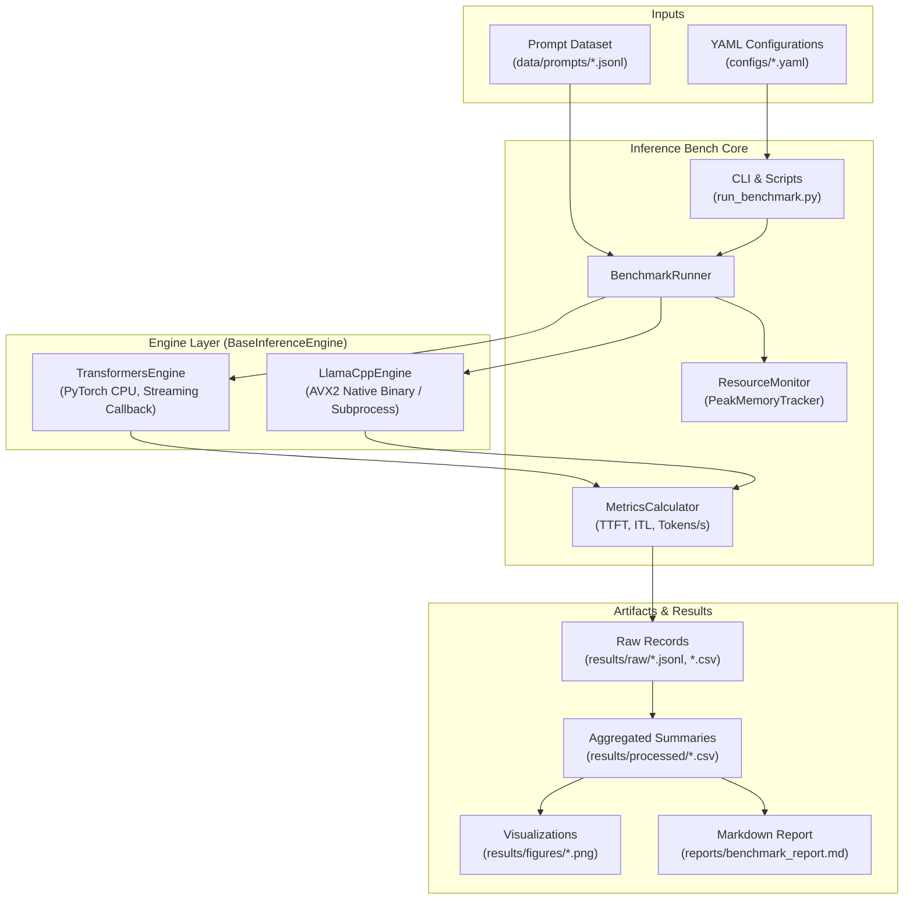

# Architecture Specification

This document details the architectural layout, component abstractions, data flow, and runtime mechanics of the **LLM Inference Benchmark & Optimization Study** suite.

---

## 1. High-Level System Architecture

The benchmark framework is engineered around a modular, decoupled engine design that isolates model execution from measurement orchestration:



---

## 2. Component Breakdown

### A. Engine Abstraction (`src/inference_bench/engines/base.py`)
All inference runtimes inherit from `BaseInferenceEngine`, enforcing a uniform contract:
- `load_model()`: Weights and tokenizers are initialized; baseline process memory is captured.
- `generate(prompt, max_new_tokens, temperature)`: Streams tokens autoregressively and returns `(output_text, token_timestamps_s, prompt_tokens, generated_tokens)`.
- `unload_model()`: Releases weight matrices and explicitly invokes `gc.collect()` to guarantee zero memory leakage between benchmark iterations.

### B. Metric Instrumentation (`src/inference_bench/metrics.py`)
- High-resolution monotonic timers (`time.perf_counter()`) avoid OS clock adjustments.
- Distinguishes initial prefill time (TTFT) from subsequent autoregressive generation steps (ITL).

### C. Resource Monitoring (`src/inference_bench/resource_monitor.py`)
- Employs a context manager (`PeakMemoryTracker`) continuously polling process RSS.
- Enforces pre-flight memory safety checks before allocating tensors or loading weights.

---

## 3. Storage Hierarchy
```
llm-inference-benchmark/
├── configs/             # Hardware profiles & execution parameters
├── data/prompts/        # Controlled prompt datasets
├── docs/                # Architecture, methodology, metrics specs
├── models/              # Downloaded GGUF & SafeTensors (git-ignored)
├── notebooks/           # Interactive analysis & roofline walkthroughs
├── reports/             # Rendered markdown comparison reports
├── results/             # Raw logs, aggregated CSVs, publication plots
├── scripts/             # Diagnostic, benchmark, and reporting CLI scripts
├── src/inference_bench/ # Core benchmark package
└── tests/               # Model-free unit test suite
```
